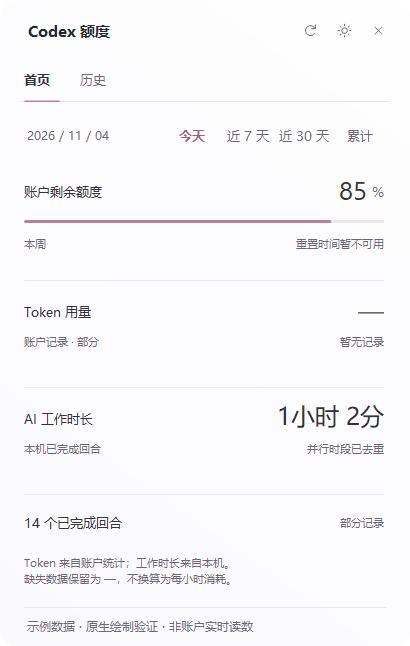

# Codex Quota

Windows 上的 Codex 额度与用量小工具，版本 **2.4.0**。独立社区工具，与 OpenAI 无官方关联。

默认采用极简主面板：细线文字导航、三行核心指标和较少的装饰。`外观 → 面板主题` 可切回玻璃主题，语言、配色、右下角显示形式和透明度会保存。

- 头像上方采用 **B 圆形玻璃环**，中心是紧凑数字，保留原附着位置。
- Windows 托盘使用数字入口；任务栏上方可选择双行玻璃卡或胶囊。角落背景透明度为 10%–80%，文字保持清晰。
- 单纯移动鼠标或失焦不再关闭面板；有意点击外部、关闭按钮或 Esc 仍可关闭。
- 开窗和切页只保留最多 2 px、约 120 ms 的轻微内容过渡，窗口本身固定且不整体闪淡。

以下为实际原生控件的离屏效果，使用测试数据展示外观，不代表当前账户状态。



[历史统计](docs/images/v2.4.0-minimal-history.png) · [外观设置](docs/images/v2.4.0-appearance.png) · [圆形玻璃头像](docs/images/v2.4.0-avatar.png)

## 下载与运行

从 [GitHub Releases](https://github.com/KIVENXQW/codex-quota/releases/latest) 下载 `CodexQuota-win-x64.zip`，完整解压到可写文件夹。打开 Codex 桌面客户端并登录，再运行 `CodexQuota.exe`。不要只复制 EXE 或在压缩包内运行。重复启动会打开已有实例。

环境：Windows 10/11 x64、.NET Framework 4.8、较新的已登录 Codex 桌面客户端，以及 Node.js 22+。工具会查找 PATH 或可识别的 Codex 配套 Node 运行时。

### 登录 Windows 后自动启动

在完整解压目录打开 PowerShell，执行一次：

```powershell
powershell.exe -NoProfile -ExecutionPolicy Bypass -File .\Start-Native.ps1 -Startup Enable -NoLaunch
```

关闭时将 `Enable` 改为 `Disable`。仅为当前用户创建启动快捷方式，不需要管理员权限；普通启动不改变设置。移动目录后从新目录重新启用，换电脑也需启用一次。

## 界面与数据

- **首页**：选定范围内的真实 Token 总消耗、剩余额度与本机 AI 工作时长，保留所有账户额度窗口和重置时间。
- **历史统计**：日周月柱状图及玻璃悬停详情、更大的分段年度 Token 热力图、集中展示累计与记录。全年已知正值分成最多五档，重复边界合并，翻页使用相同阈值；零值灰色，无记录空心。色阶反映全年分布，不是按最大值线性比例。
- **外观**：Microsoft YaHei UI、玫瑰玻璃层次、中英文与配色设置，右下角三种形式和背景透明度；页面切换尊重 Windows 动画设置。
- **窗口跟随**：标记为 Codex 子窗口；切到旁边浏览器且头像仍可见时保留，最小化或头像被遮挡时隐藏。
- **更新**：面板“有更新”、托盘角标和短暂玻璃提醒通向同一更新页，展示真实版本、说明、下载与校验状态。

Token 来自账户统计，可能延迟。工作时长和已完成回合来自本机最近90天可读元数据，排除回合间用户空闲并合并并行时段。这不是全部设备历史；缺失数据不会当作零。

账户 Token 与本机时长覆盖范围不同，精确消耗速度暂显示不可用。逐任务 Token、模型占比、输入/输出/缓存分项和成本没有已验证的数据源，不用示例填补。积分不是现金余额。

## 更新

`update-source.json` 指向公开仓库 `KIVENXQW/codex-quota`，不需要令牌。默认启动检查，周期24小时；右键托盘“检查更新”立即执行。`checkOnStartup: false` 只跳过启动检查。

安装前校验 ZIP 和每个文件，独立助手替换并重启额度工具，失败回滚；保留本机数据、语言、颜色和来源配置，不关闭 Codex。

**下载和安装过程使用当前已安装版本的更新页；完成后进入 2.4.0 的极简主面板。** 旧安装目录的 `repository` 若为空，需设为 `KIVENXQW/codex-quota`。推送代码不会触发升级，需发布更高版本正式 Release。详见 [UPDATES.md](UPDATES.md)。

## 隐私与构建

凭据由 Codex 管理，不在工具中填写密码或 API Key。不读取聊天正文；`.data/`、`.run/`、备份、截图和交接记录不进入发布包。

```powershell
.\Build-Native.ps1
.\Build-Release.ps1
node --test
```

使用 .NET Framework 的 `csc.exe`，无需 .NET SDK。版本来自 `version.json`；输出到 `dist/v2.4.0/`。新增原生源代码编译进 EXE，保留旧更新器的运行文件名单。

## English

Codex Quota is an independent Windows companion for Codex Desktop. Extract the entire release ZIP and run CodexQuota.exe. Version 2.4.0 defaults to a minimal Home/History panel; the glass theme remains selectable in Appearance. The avatar entry uses a circular glass ring. The tray remains a numeric entry, with optional floating card/capsule and adjustable background transparency.

Mouse movement or focus loss alone no longer dismisses the panel. Outside clicks, close and Escape remain available. Transitions use at most 2 logical pixels over 120 ms without moving or fading the entire window.

Local work records cover available metadata from this PC over the last 90 days. Account Tokens and local work time differ in scope; unavailable per-hour and per-task/model breakdowns are not fabricated. Chat bodies are not collected. Updating preserves local data and preferences and restarts only the companion.
