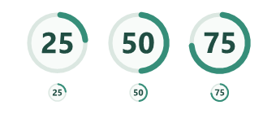

# Codex 周额度 · 极简版

Windows 上的独立小工具，显示当前 Codex 账户的周额度剩余，以及北京时间重置时刻。头像上方的青绿色圆环按剩余额度着色，点击即可打开面板。

## 下载与启动

从 [1.2.2 正式版](https://github.com/KIVENXQW/codex-quota/releases/tag/weekly-v1.2.2) 下载 CodexWeekly-win-x64.zip，完整解压后双击 CodexWeekly.exe。需要 Windows x64、.NET Framework 4.8、已登录的 Codex 桌面客户端及 Node.js 22+（可以使用本机 Codex 配套的 Node）。

额度每分钟刷新一次。F5 可立即刷新，Esc 收起至托盘。退出可用托盘菜单。1.1.0 及之后的极简版可以从托盘检查更新，在发现新版后打开发行页。发布标签使用 weekly-v 加版本号。

## 1.2.2

- 侧栏使用圆头细环，剩余 50% 时，绿色覆盖右半圈。
- 中心读数使用 Segoe UI Bold，按照每个读数的字形轮廓居中。
- 额度不可用时显示破折号；主面板展示周剩余百分比、进度条及重置时间。

## 构建

在 Windows PowerShell 中执行 Build.ps1。脚本编译 C# 原生窗口，并运行额度、更新、圆环和侧栏检查。项目使用 Node.js 标准库，通过本机 Codex 客户端查询周额度。

本分支为极简周额度版。完整版见[主分支](https://github.com/KIVENXQW/codex-quota/tree/main)。